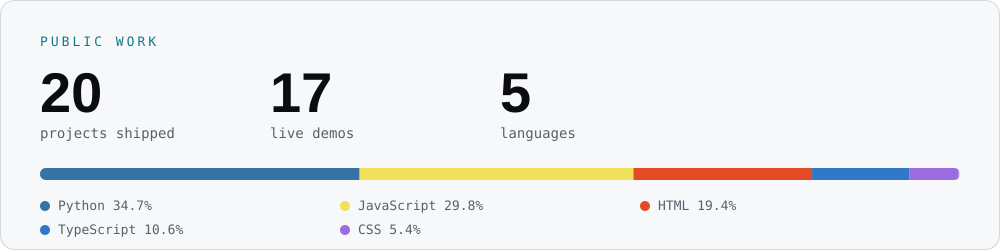

<picture>
  <source media="(prefers-color-scheme: dark)" srcset="assets/banner-dark.svg">
  
</picture>

I'm co-founding [Unizel](https://unizel.com). We build simulated companies where AI agents do real accounting work, graded to the cent.

Alongside that I publish small, finished tools built on one idea: let the model propose, let code check it, and send the unclear cases to a person. Computer Science and Economics, Case Western Reserve University, 2026.

<picture>
  <source media="(prefers-color-scheme: dark)" srcset="assets/stats-dark.svg">
  
</picture>

## Featured

| Project | What it does |
| --- | --- |
| [billing-support-assistant](https://github.com/Duckky153/billing-support-assistant) ([live demo](https://duckky153.github.io/billing-support-assistant/)) | Billing support where the AI proposes refunds and cancellations, code checks each one against the customer's records and billing rules, and unclear requests go to a person. |
| [tripwire](https://github.com/Duckky153/tripwire) ([results](https://duckky153.github.io/tripwire/)) | Adversarial test harness and independent deny-by-default action gate for tool-using AI agents: 44-class attack catalog, seed-reproducible runs, hash-chained audit log. |
| [acquisition-launchpad](https://github.com/Duckky153/acquisition-launchpad) | Phase 1 of a finance onboarding tool for acquired companies: human-reviewed account mapping, exact trial-balance tie-outs, readiness checks and a hash-chained audit trail. Sample data; later phases are planned, not built. |
| [rescue-desk](https://github.com/Duckky153/rescue-desk) | Turns an ERP contract PDF into page-cited facts, has a person accept, correct or reject each one, calculates what is still owed with fixed formulas, and exports a review packet. Runs locally. |
| [faultline](https://github.com/Duckky153/faultline) ([live page](https://duckky153.github.io/faultline/)) | A small orders service instrumented with OpenTelemetry: flip a fault switch and the failing step shows up in the trace. |
| [consumer-complaint-operations](https://github.com/Duckky153/consumer-complaint-operations) ([live demo](https://duckky153.github.io/consumer-complaint-operations/)) | Dashboard of 84,194 public CFPB checking and savings complaints from 2025 that shows which patterns to review first. Python, SQLite, SQL, Chart.js, plus a Tableau version. |

Demos run on synthetic or public data, and each repository says which.

<b>More projects</b>

 

**Agent evaluation and review** (synthetic data)

- [ask-once](https://github.com/Duckky153/ask-once) ([demo](https://duckky153.github.io/ask-once/)): support inbox drafter that drafts replies from help pages and holds risky requests for a person.
- [expert-test-round](https://github.com/Duckky153/expert-test-round) ([demo](https://duckky153.github.io/expert-test-round/)): pre-launch expert test round for a product-support agent, where every miss gets an owner.
- [shadow-run-scorecard](https://github.com/Duckky153/shadow-run-scorecard) ([demo](https://duckky153.github.io/shadow-run-scorecard/)): decides when a new shipper's AI-entered orders can skip human review.
- [benchmark-failure-readout](https://github.com/Duckky153/benchmark-failure-readout) ([demo](https://duckky153.github.io/benchmark-failure-readout/)): splits the gap between two APIs by company type and failure reason.

**Review queues and monitoring**

- [issue-triage](https://github.com/Duckky153/issue-triage) ([demo](https://duckky153.github.io/issue-triage/)): review queue for public GitHub issues from n8n, Grafana and Kubernetes, with source links, evidence and CSV/JSON handoff.
- [maintenance-checker](https://github.com/Duckky153/maintenance-checker) ([demo](https://duckky153.github.io/maintenance-checker/)): checks CoreWeave's public status page and RSS feed for conflicting maintenance details and builds a review-gated calendar.
- [kairos-watchers](https://github.com/Duckky153/kairos-watchers): credential-free GitHub Actions cron that polls 10 public feeds and commits a content-hash observation when one changes.

**Go-to-market analysis**

- [gtm-signal-engine](https://github.com/Duckky153/gtm-signal-engine) ([demo](https://duckky153.github.io/gtm-signal-engine/)): ranks accounts by buying signal from public ATS job boards, with no API keys and no paid data vendor. Snapshot from August 8, 2026.
- [reseller-payout-checker](https://github.com/Duckky153/reseller-payout-checker) ([demo](https://duckky153.github.io/reseller-payout-checker/)): reseller rev-share payout checker with whole-cent math and held exceptions (synthetic data).
- [signup-account-rollup](https://github.com/Duckky153/signup-account-rollup) ([demo](https://duckky153.github.io/signup-account-rollup/)): rolls developer-API signups up to companies and picks the accounts worth a conversation (synthetic data).
- [trades-hiring-signals](https://github.com/Duckky153/trades-hiring-signals) ([demo](https://duckky153.github.io/trades-hiring-signals/)): ranks home-service shops to call first from job posts (synthetic data).
- [channel-adoption-readout](https://github.com/Duckky153/channel-adoption-readout) ([demo](https://duckky153.github.io/channel-adoption-readout/)): which pages bring signups who keep running workflows (synthetic data).
- [channel-cac-ledger](https://github.com/Duckky153/channel-cac-ledger) ([demo](https://duckky153.github.io/channel-cac-ledger/)): cost per paid practice by channel, turned into next month's budget (synthetic data).
- [lead-feedback-readout](https://github.com/Duckky153/lead-feedback-readout) ([demo](https://duckky153.github.io/lead-feedback-readout/)): readout of the leads sales reps turn down (synthetic data).

## Elsewhere

[Unizel](https://unizel.com) · [LinkedIn](https://www.linkedin.com/in/dakshitraj/) · [Personal page](https://duckky153.github.io)
